# supply-scan roadmap

Working title. This file is the work plan. [ARCHITECTURE.md](ARCHITECTURE.md) describes the code that exists today. When they disagree, the code and `ARCHITECTURE.md` win, and this file should be updated.

Last reviewed 2026-10-29. The local page, the ignore list, and scan comparison are in the tree. Composer and pub were checked on real repositories from the page. Next is a clone that does not check files out, then a scan of several repositories at once. `ARCHITECTURE.md` still describes the command-line scan and does not yet describe the page.

## How to use this file

Work top to bottom inside [Next](#next). Finish the numbered item you are on before starting the next one. Do not start [Later](#later) while a Next item is still open. [Parked](#parked) items are written down so they are not rediscovered as new ideas. They are not commitments. [Out of scope](#out-of-scope) stays out.

An item is done when its "Done when" lines are true and `python -m unittest tests.test_scan` still passes. Tests stay offline. A live OSV call is a manual check, not part of the suite.

```mermaid
flowchart TD
    Start([Scan and report already work]) --> Cache["Cache OSV answers for 24 hours"]
    Cache --> Npm["Fix npm dev and prod labels"]
    Npm --> Hydrate["Fetch full advisories together"]
    Hydrate --> Pnpm["Read a pnpm lock, or say it was not understood"]
    Pnpm --> GoReplace["Mark a Go replace as unchecked"]
    GoReplace --> Cargo["Look up the real crates.io name"]
    Cargo --> Screen["Ignore list and scan comparison, on a screen"]
    Screen --> Composer["Read composer.lock"]
    Composer --> Pub["Read pubspec.lock"]
    Pub --> Ruby["Read Gemfile.lock"]
    Ruby --> Yarn["Read yarn.lock after the other JavaScript locks"]
    Yarn --> Gradle["Read a Gradle lock or version catalog"]
    Gradle --> Maven["Read literal versions in pom.xml"]
    Maven --> VersionSort["Sort a pre-release the way its package manager does"]
    VersionSort --> NoCheckout["Clone without checking files out"]
    NoCheckout --> Parallel["Scan several repositories at once"]
    Parallel --> Parked["Leave direct-only and offline listing"]

    classDef done fill:#90EE90,stroke:#333,stroke-width:2px,color:darkgreen
    classDef next fill:#87CEEB,stroke:#333,stroke-width:2px,color:darkblue
    classDef later fill:#E6E6FA,stroke:#333,stroke-width:2px,color:darkblue
    classDef parked fill:#FFD700,stroke:#333,stroke-width:2px,color:black

    class Start,Cache,Npm,Hydrate,Pnpm,GoReplace,Cargo,Screen,Composer,Pub,Ruby,Yarn,Gradle,Maven,VersionSort done
    class NoCheckout,Parallel next
    class Parked parked
```

The same diagram is saved at `diagrams/roadmap_01_flowchart_work_order.mmd`.

## Done

These are in the tree. They are listed so the next change does not rebuild them.

- [x] **Scan a repo and print a verdict.** From this directory, `python -m supply_scan <git-url | local-path>` reads resolved versions, asks OSV, writes `supply-scan-report.json`, and exits `0`, `1`, or `2` as `ARCHITECTURE.md` describes. `--html` writes the text report as a page. `--strict` also fails on dev dependencies and medium severity.
- [x] **Reuse OSV answers for one day.** `supply_scan/cache.py` stores batch rows and full advisories under `%LOCALAPPDATA%\supply-scan` on Windows, or `$XDG_CACHE_HOME/supply-scan`, or `~/.cache/supply-scan`. A second scan of the same ecosystem, name, and version skips the network until the entry is older than 24 hours. Stderr prints `osv: N cached, M fetched`. `--no-cache` always asks OSV. A cache that cannot be written does not fail the scan.
- [x] **Mark npm packages that only exist for development.** In `package-lock.json` v2 and v3, `inventory._npm_lock_v2` walks the lock. A package reached only from a `devDependencies` edge is `dev`, even when its own entry does not say `dev`. A package also reached from a production dependency stays production. The default exit code does not fail on the dev-only package. `--strict` still does.
- [x] **Fetch full advisories together.** `query_osv` passes `hydrate` a function that reads the advisory cache and then downloads. `hydrate` runs that function in a pool of 8 whenever more than one distinct id needs a body. Duplicate ids are fetched once. An offline test holds two stub fetches in flight at the same time.
- [x] **Apply Go `replace` before the query.** A local path or a different module path is unchecked and is not sent to OSV. The same module path is queried at the replacement version. A version on the left of `=>` matches only that require. On `kubernetes/kubernetes` master `061e55d`, 161 local replaces were unchecked, including `k8s.io/api` to `./staging/src/k8s.io/api`, and 408 other modules were queried.
- [x] **Query Cargo by the crates.io name.** `package = "serde"` is the OSV name. The manifest key is kept as `alias` and printed as `as serde1` when it differs. A clean rename is in the JSON only, because the text omits clean packages. A `git+` source stays unchecked. `curve25519-dalek` at `61533d75` queried `rustcrypto-ff` and `rustcrypto-group` with aliases `ff` and `group`.
- [x] **Open the scan on a local page.** `python -m supply_scan.serve`, or `serve.bat`, listens on `127.0.0.1` only, port 8765 unless `--port` is set, and serves `gui/index.html`. The page is read from disk on each request. Python changes need a restarted server. A scan takes a git URL or a local directory. A git URL loads the remote branch list, and that full list stays after the scan. The branch box says "Enter target first" until a git URL is entered. Browse reads lockfiles through the browser's own folder window and posts them to `/scan`. The server does not open a folder dialog.
- [x] **Keep finished scans and write them out.** A successful page scan is stored under the cache directory's `scans` folder, the same root as the OSV cache: `%LOCALAPPDATA%\supply-scan\scans` on Windows. The history label is time, repo, and branch. Choosing a row does nothing until **Open** or **Compare** is pressed. **Save report** suggests a name from the repo, the branch, and the time. A comparison name puts `vs` between the two sides. **Open report** accepts a scan file or a comparison file.
- [x] **Ignore an advisory without removing it.** `supply_scan/ignore.py` stores the acceptance in `ignore.json` beside the cache, keyed by ecosystem, name, version, and advisory id. The finding stays on the page and says Ignored. **Open findings only** hides those rows on the page. The exit code, on the page and in the CLI, still counts an ignored finding. An ignore needs an ecosystem, a name, and an advisory id.
- [x] **Compare two scans on the page.** `compare_reports` in `supply_scan/compare.py` decides the package identity: ecosystem and name. The version is what changed. The page paints `rows`. [COMPARE.md](COMPARE.md) is the type table and the two columns. One line says `Same repository` or `Different repositories`. A comparison file has `"kind": "supply-scan-comparison"` plus `current`, `previous`, and `rows`. The CLI has no diff mode.
- [x] **Read a pnpm lock, or say it was not understood.** `parse_pnpm_lock` reads lockfile v6 (top-level `dependencies`, `/name@version`) and v9 (`importers`, `name@version`). A v6 fixture and a v9 fixture both resolve `lodash`, `vitest`, and `@scope/pkg`. A lockfile version other than 6 or 9, or a `packages` key the line parser does not know, becomes one unchecked row, `pnpm lockfile shape was not recognised`. Matching keys in that file are not returned. The scan does not install packages and does not use a YAML library.
- [x] **Read composer.lock.** `parse_composer_lock` reads `packages` and `packages-dev`. `packages-dev` is dev. Names in `composer.json` `require` are direct prod, matched without case, so `Monolog/monolog` is `monolog/monolog`. Names in `require-dev` are direct dev. The fixture queries `monolog/monolog` `v3.5.0`, `symfony/console` `v6.4.8`, `psr/log` `3.0.0`, and `phpunit/phpunit` `10.5.20` on Packagist. A release is still queried when the lock also records a git checkout beside a zip dist. `2.0.x-dev` is unchecked as `branch, not a Packagist release`. `dev-main` is unchecked as `dev version, not a Packagist release`. A git source with no zip or tar, `acme/git` `1.4.0`, is unchecked as `git source, not a Packagist release`. Those three are not sent to OSV. The scan does not run Composer. The page's folder list accepts `composer.lock` and `composer.json`. On the page, Symfony Demo `main` returned 153 packages and 0 unchecked, with `league/commonmark` `2.10.0` from `composer.lock`.
- [x] **Read a pub lock, or the ranges in pubspec.yaml.** `parse_pubspec_lock` reads hosted packages on Pub. `direct main` is direct prod, so `collection` `1.18.0` is queried. `direct dev` is direct dev, so `lints` `3.0.0` is queried. `transitive` stays transitive, so `async` `2.11.0` is queried and is not direct. A git, path, or sdk source is unchecked and is not sent to OSV. A `pubspec.yaml` with no `pubspec.lock` in that directory or a parent keeps an exact `1.2.3` and marks a range unchecked, the same way a bare `package.json` does. The scan does not run the pub client. There is no YAML library. The page's folder list accepts `pubspec.lock` and `pubspec.yaml`. On the page, Flutter Gallery `main` returned 105 packages, with the 7 unchecked rows as SDK sources such as `flutter` and `flutter_test`. `dart-lang/http` `master` has no lockfile, so every row came from `pubspec.yaml` and stayed unchecked, including the range `async ^2.5.0`.
- [x] **Read Gemfile.lock.** `parse_gemfile_lock` reads specs under `GEM` whose remote is `rubygems.org` or `index.rubygems.org`. A platform suffix is removed, so `nokogiri` `1.16.5` and `nokogiri` `1.16.5-x86_64-linux` are one query, `1.16.5`, and `json` `2.7.1-java` is `json` `2.7.1`. Names under `DEPENDENCIES` are direct. `rails` `7.1.3` is direct prod. `actionpack` `7.1.3`, `rack` `3.0.8`, and `racc` `1.7.3` are transitive prod. A `development` or `test` group in the Gemfile is dev, so `rubocop` `1.60.2` is direct dev and `minitest` `5.20.0` is transitive dev. `rake` is in the test group and is also required by `rails`, so it stays prod. `git_pkg` `0.2.0` is unchecked as `git source, not a RubyGems release`. `path_pkg` `0.1.0` is unchecked as `path source, not a RubyGems release`. `sidekiq-pro` from `https://gems.example.com/` is unchecked as `gem source, not RubyGems`. A plugin source is unchecked as `plugin source, not a RubyGems release`. Those rows are not sent to OSV. A gem named only in the Gemfile, `missing` `9.9.9`, is not added when that directory has a lock. A Gemfile with no `Gemfile.lock` in that directory keeps an exact `rake` `13.2.1` and marks `rails` `~> 7.1` unchecked. A parent lock does not hide that child Gemfile. The scan does not run Bundler. The page's folder list accepts `Gemfile.lock` and `Gemfile`. On the page, a posted folder resolved `nokogiri` `1.16.5` and transitive `racc` `1.7.3` from `Gemfile.lock`.
- [x] **Read yarn.lock.** `parse_yarn_lock` reads classic v1 and a Berry lock (`__metadata`). The OSV ecosystem stays npm. Direct and dev come from every `package.json` that lock owns, including a child. In the classic fixture, `lodash` `^4.17.21` is `4.17.21`, direct prod. `@scope/pkg` `1.2.3` is transitive prod. `something` `1.0.0` is required by both `lodash` and `vitest`, so it stays prod. `vitest` `1.6.0` is direct dev because `packages/app/package.json` lists it under `devDependencies`, and `vite` `5.0.0`, reached only from `vitest`, is transitive dev. `string-width-cjs@npm:string-width@^4.2.0` is queried as `string-width` `4.2.3` with alias `string-width-cjs`. `left-pad` `1.2.0` is unchecked as `git source, not an npm release`. `local` is unchecked as `file source, not an npm release`. A `link:` source uses that same file reason. The child range `express` `^4.18.0` is not added. The Berry fixture resolves the same `lodash`, `@scope/pkg`, `something`, `vitest`, and `vite` labels. `demo@workspace:.` is unchecked as `workspace source, not an npm release` at `0.0.0-use.local` and is not direct. `ui@workspace:packages/ui` is the same reason and is direct. `left-pad` resolved from `https://github.com/...` is `git source, not an npm release`. `portal` is `portal source, not an npm release`. `patched` `1.2.3` is `patch source, not an npm release`. An `exec:` source is `unsupported yarn source`. The `__metadata` version `6` is not a package. Those unchecked rows are not sent to OSV. A file that is neither classic nor Berry, a mix of both version lines, or a tab-indented lock is one unchecked row, `yarn lockfile shape was not recognised`. `yarn.lock` is skipped when that directory has `package-lock.json` or `pnpm-lock.yaml`: the package-lock fixture keeps `left-pad` `1.2.3` and drops yarn's `lodash` `4.17.21`, and the pnpm fixture keeps `lodash` `4.17.20`. The scan does not run Yarn and does not use a YAML library. The page's folder list accepts `yarn.lock`. On the page, a posted folder resolved `lodash` `4.17.21`, direct dev `vitest` `1.6.0`, and transitive dev `vite` `5.0.0` from `yarn.lock`.
- [x] **Read a Gradle lock or version catalog.** `parse_gradle_lock` reads `group:artifact:version=configurations` and queries Maven as `group:artifact`. A configuration name that contains `test` is dev only when every configuration on that line does, so `org.junit.jupiter:junit-jupiter` `5.10.2` is direct dev and `com.google.guava:guava` `31.1-jre` stays prod. `com.google.guava:failureaccess` `1.0.1` is transitive prod. `empty=` is not a package. `org.slf4j:slf4j-api` `1.+` on a lock line is unchecked as `version is a range, no lockfile`. Names in the nearest `libs.versions.toml` are direct, so the lock row for `guava` keeps alias `guava, short`. `parse_version_catalog` queries a literal version and a `version.ref` that points at a literal: `org.apache.commons:commons-lang3` `3.14.0` and the string form `org.apache.commons:commons-lang3:3.14.0`. A module the lock already names is kept from the lock, so catalog `slf4j` `2.0.9` does not replace lock `1.+`. The lock is the preferred record: a line `org.slf4j:slf4j-api:1.7.36` is queried, and catalog `org.slf4j:slf4j-api` `1.+` is dropped. A literal written only in the catalog is the weaker check. It covers that one module, and other ranges stay unchecked. The scan does not expand `1.+`. `org.slf4j:slf4j-simple` `1.+`, a rich `{ strictly = "[1.0, 2.0[", prefer = "1.5.0" }`, and a `version.ref` to that rich table are unchecked as `version is a range, no lockfile`. A missing `version.ref` and a library with no version are unchecked as `version is not written in the repo`. Plugin `org.springframework.boot` `3.2.5` is unchecked as `Gradle plugin, not a Maven module`, with alias `spring`. A plugin range stays `version is a range, no lockfile`. A bad lock line is one unchecked row, `gradle lockfile shape was not recognised`, and earlier modules in that file are not kept. A version catalog that is not TOML is `could not parse`. A TOML file that is not a catalog is `version catalog was not recognised`. `gradle/libs.versions.toml` wins over a `libs.versions.toml` beside it. A `build.gradle` or `build.gradle.kts` is not read. With no lock and no literal catalog version, the script is one unchecked row, `Gradle script, no lockfile`, so `implementation 'com.google.guava:guava:31.1-jre'` is not queried. A literal in the catalog covers the script, and a lock in that directory does too. A lock in `app/gradle.lockfile` still takes direct and alias from the root catalog. The scan does not run Gradle. The page's folder list accepts `gradle.lockfile` and `libs.versions.toml`. On the page, a posted folder resolved `com.google.guava:guava` `31.1-jre` from `gradle.lockfile`, direct dev `org.junit.jupiter:junit-jupiter` `5.10.2`, transitive `com.google.guava:failureaccess` `1.0.1`, and catalog-only `org.apache.commons:commons-lang3` `3.14.0`.
- [x] **Read literal versions in pom.xml.** `parse_pom` queries a dependency whose `groupId`, `artifactId`, and `version` are written in the repo, as Maven `groupId:artifactId`. Scope `test` is dev. A property name is followed when `<properties>` in that pom, or in a parent pom in the repo, sets it to a concrete version. In the fixture, parent `<revision>1.0.0</revision>` makes the project version `1.0.0`, so `com.example:lib` `${project.version}` is queried at `1.0.0`. Parent `<guava.version>31.1-jre</guava.version>` makes `com.google.guava:guava` `31.1-jre`. A literal `org.apache.commons:commons-lang3` `3.14.0` is queried. A version in the parent's `dependencyManagement` fills a dependency that omits `<version>`, so `org.slf4j:slf4j-api` is `2.0.9`. A BOM import is queried when its own version is written, so `org.junit:junit-bom` `5.10.2` is queried, and it does not fill other versions. `junit:junit` `${missing.version}` stays unchecked as `version is not written in the repo`, and it is dev. `org.apache.logging.log4j:log4j-api` `[2.0,3.0)` stays unchecked as `version is a range, no lockfile`. `org.junit.jupiter:junit-jupiter` has no version in the repo, so it stays unchecked and keeps the import name `org.junit:junit-bom`. An empty `<relativePath/>` means the parent is not in the repo: `com.google.guava:guava` `31.1-jre` is still queried, and `org.slf4j:slf4j-simple` stays unchecked with the parent name `org.springframework.boot:spring-boot-starter-parent`. Those unrecognised names are listed once, after the unchecked rows, as `unrecognised names`. A broken pom is one row, `could not parse pom.xml`. The scan does not run Maven. The page's folder list accepts `pom.xml`. On the page, a posted folder resolved `com.google.guava:guava` `31.1-jre` from `pom.xml` and listed `missing.version` at the end.
- [x] **Sort a pre-release the way its package manager does.** `version_tuple` orders a fix before `recommend` collapses the fixes into one `upgrade to` line. The printed version stays the advisory's text. npm, Go, crates.io, and Pub use SemVer, so `1.0.0-alpha` is before `1.0.0-alpha.1`, `1.0.0-rc.2` is before `1.0.0-rc.10`, and both are before `1.0.0`. `1.0`, `1.0.0`, and `1.0.0+build` are the same version. Packagist uses Composer, so `1.0.0-alpha` is before `1.0.0-RC`, `1.0.0-RC2` is before `1.0.0-RC10`, and `1.0.0-RC10` is before `1.0.0`, which is before `1.0.0-p1`. `v3.5.0` and `3.5.0` are the same version. PyPI uses PEP 440, so `1.0.0.dev1` is before `1.0.0a1`, `1.0.0rc1` is before `1.0.0`, and `1.0.0` is before `1.0.0.post1`. `1.0.0rc1`, `1.0.0.rc.1`, and `1.0.0rc.1` are the same version. `1.0.0+ubuntu` is after `1.0.0`, and `1!1.0` is after `2.0`. A leading `v` on PyPI does not parse. RubyGems reads a hyphen as `.pre.`, so `1.0.0-rc1` is before `1.0.0`, and `1.0.0.beta9` is before `1.0.0.beta10`, which is before `1.0.0`. Maven uses its qualifier order, so `1-snapshot` is before `1`, `1` is before `1-sp`, and `1-sp` is before `1-jre`. `1`, `1.0`, `1.0.0`, `1.ga`, and `1-ga` are the same version. `1-ga1` is after `1`. `31.1` is before `31.1-jre`, so a finding fixed in `31.1-jre` and `32.0.0-jre` upgrades to `32.0.0-jre`. `+` is not build metadata on Maven. Two npm fixes, `1.0.0-rc.1` and `1.0.0-rc.2`, collapse to `upgrade to 1.0.0-rc.2` when no higher release is present. A release still wins, so `1.0.0-rc.2` and `1.0.0` upgrade to `1.0.0`. npm `1.0.0-rc.01`, Packagist `1.0.0-alpha.beta`, and a version with no ecosystem stay on their own `fixed in` lines, and there is no `upgrade to` line.

## Next

- [ ] **Clone without checking files out.** A remote URL is still cloned with `git clone --depth 1` into `%TEMP%\supply-scan-repos`, with `-b` when `--branch` is set, and the directory is still deleted afterwards. The clone adds `--no-checkout`. The process environment sets `GIT_CONFIG_NOSYSTEM=1`, points `GIT_CONFIG_GLOBAL` at an empty file, and sets `GIT_TERMINAL_PROMPT=0`. The command also passes `-c submodule.recurse=false`, `-c credential.helper=`, and `-c protocol.file.allow=never`. After the fetch, `git ls-tree -r HEAD` lists the tree. Only paths `scan_tree` already reads are copied out, by writing blob bytes, and the existing walk scans that partial tree. Those paths keep their repository-relative directories, so a nested lock still owns the child manifest. A symlink or a submodule gitlink is not written. A single blob or the set of copied files that exceeds the page's posted-folder caps (2000 files, 48 MB) fails the clone. A local directory is still scanned in place. A folder posted by the browser is unchanged. The page's git URL uses this same clone.

  Done when:

  - An offline test builds the clone command and environment and sees `--no-checkout`, the three `-c` settings, and the three environment variables.
  - An offline test writes a partial tree of known manifests and `scan_tree` returns the same rows it returns for a full checkout of those files.
  - `python -m unittest tests.test_scan` still passes.

- [ ] **Scan several repositories at once.** One command takes more than one target. At most four run at the same time. A package version or an advisory id that appears in more than one of those targets is fetched once and shared. Each target keeps its own text report, its own JSON file, and its own exit code. One target that cannot be opened, or whose OSV call fails, exits `2` for that target and the others still finish. The process exits with the worst of those codes: `2`, then `1`, then `0`. A single target still writes `supply-scan-report.json` and keeps today's exit code. History rows are written one at a time, including two scans that finish together on the page, so a row is not dropped. OSV is not given a new rate cap. The public API publishes none. The limit of four is the clone bandwidth and the temp disk.

  Done when:

  - An offline test runs three targets, holds the OSV calls, and sees one fetch for a version shared by two targets.
  - An offline test fails the middle target and still returns reports for the other two. The process exit code is `2`.
  - An offline test writes two history rows from overlapping saves and both rows remain in the index.
  - `python -m unittest tests.test_scan` still passes.

Do not start [Later](#later) while a Next item is open. Finish the clone item before this one.

## Later

Nothing is queued. The ignore list and the scan comparison are in [Done](#done). Do not add a new item here while [Next](#next) is still open. Do not change the CLI exit code when a finding is ignored, and do not add a diff mode to the command.

## Parked

Leave these until a real project needs them. VendorPulse, the repo used as a fixture, is npm plus Python, which the tool already reads.

| Item | Why it is parked |
| --- | --- |
| Direct dependencies only | A lockfile has the packages the project names, and the packages those packages pull in. A bug in a pulled-in package still ships. A switch that hides those would be a narrower report, not a more correct one. |
| Scan with no network | Feasible only as "list the versions and mark every one unchecked." The vulnerability check is a lookup in OSV. There is no local detection engine to build. |

## Out of scope

These were excluded when the tool was cut out of VendorPulse. The roadmap does not pick them up.

- Installing packages to resolve a range. No `npm install`, `yarn`, `pip install`, `cargo fetch`, `go build`, `composer install`, `bundle install`, `pub get`, Gradle, or Maven. A Gradle `1.+` stays unchecked until `gradle.lockfile` names the release. A literal in `libs.versions.toml` is not that release.
- Deciding whether the vulnerable function is actually called.
- License checks, typosquat detection beyond OSV `MAL-` ids, provenance, or signatures.
- Opening an upgrade pull request. The report names the version.
- SARIF output. JSON is the machine format.
- A database, accounts, Slack, or a built-in schedule. CI runs the command. The exit code is the signal.
